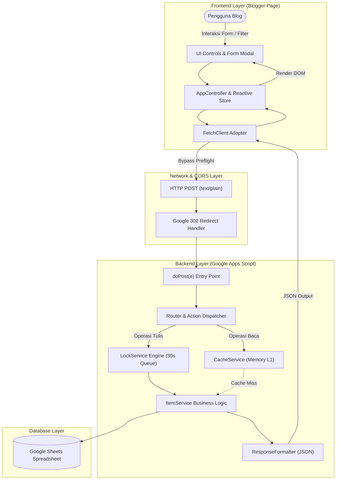
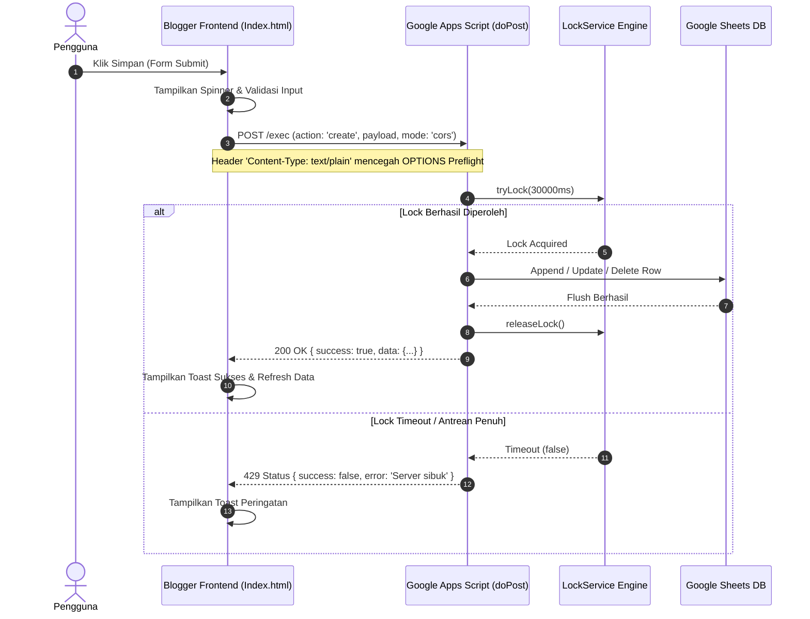

# Arsitektur Sistem: GAS + Blogger Web App

Dokumen ini menguraikan arsitektur teknis, alur data (*data lifecycle*), penanganan *concurrency* (*race condition*), serta mekanisme *bypass* CORS antara antarmuka Blogger dan Google Apps Script.

---

## 🏛️ Diagram Arsitektur Alur Data



---

## 🔄 Sequence Diagram: Operasi Write (Create / Update / Delete)



---

## 🔑 Komponen Kunci Arsitektur

### 1. Solusi Masalah CORS & 302 Redirect pada Google Apps Script
Google Apps Script Web App memiliki perilaku unik:
1. **Tidak Mendukung CORS Preflight (`OPTIONS`)**: Jika frontend mengirimkan request dengan header `Content-Type: application/json`, browser modern akan mengirimkan permintaan preflight HTTP `OPTIONS`. GAS akan merespons dengan kegagalan (405/CORS error).
   - **Solusi**: Menggunakan `Content-Type: text/plain;charset=utf-8` saat mengirim `fetch()`. Browser menganggap ini sebagai *simple request* sehingga langsung mengirimkan `POST` tanpa preflight `OPTIONS`. Di sisi backend, `JSON.parse(e.postData.contents)` tetap mampu membaca isinya dengan sempurna.
2. **HTTP 302 Redirect**: GAS selalu me-redirect URL deployment awal ke server backend sementara Google (`script.googleusercontent.com`).
   - **Solusi**: Frontend menyertakan opsi `redirect: 'follow'` pada konfigurasi `fetch`.

### 2. Concurrency Control dengan Lock Engine
Google Sheets bukanlah sistem database relasional murni dengan fitur ACID built-in tingkat rendah. Jika dua pengguna menekan tombol "Simpan" pada milidetik yang sama, kedua request dapat menimpa baris yang sama (*race condition*).

Modul `LockEngine` pada `templates/Kode.gs` menggunakan `LockService.getScriptLock()`:
```javascript
const lock = LockService.getScriptLock();
const hasLock = lock.tryLock(CONFIG.LOCK_TIMEOUT_MS); // Batas tunggu 30 detik
try {
  if (!hasLock) throw new Error('Server sibuk...');
  return criticalFunction();
} finally {
  lock.releaseLock(); // Selalu dilepas walau terjadi error
}
```
Mekanisme ini memastikan antrean serial aman untuk setiap operasi tulis.

### 3. Layer Caching Cerdas
Untuk mempercepat pembacaan data (misalnya saat ribuan pengunjung membuka blog), `ItemService` memanfaatkan `CacheService.getScriptCache()`:
- Data `list` disimpan dalam memory cache selama 5 menit (`300 detik`).
- Setiap kali ada operasi tulis (`create`, `update`, `delete`), cache otomatis di-invalidasi (`invalidate('items_list')`) agar pengunjung langsung mendapatkan data terkini.
